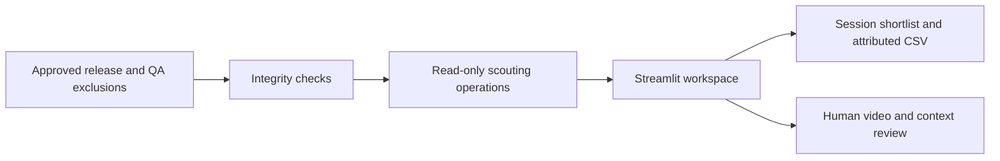
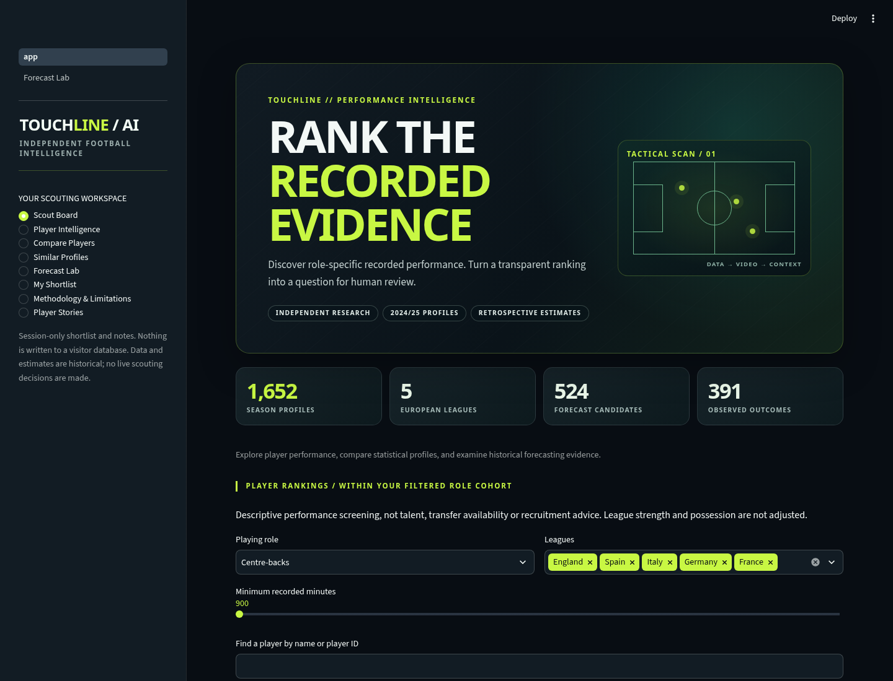

# Touchline AI - Football Player Intelligence

**Independent football analytics. From performance data to better scouting questions.**

Explore player performance, compare statistical profiles, and examine historical forecasting evidence.

- Live demo: [Touchline AI on Streamlit](https://touchline-ai.streamlit.app/) — publicly accessible interactive scouting dashboard with historical player profiles.
- Portfolio: [mrtrauf.github.io](https://mrtrauf.github.io/).

## Scouting workflow

Discover → Rank → Inspect → Compare → Shortlist → Review evidence.

Eight views: **Scout Board**, **Player Intelligence**, **Compare Players** (two or three records), **Similar Profiles**, **Forecast Lab**, **My Shortlist**, **Methodology & Limitations**, and **Player Stories**. Shortlists, priorities and notes last only for the visitor's Streamlit session; attributed downloads protect against CSV formula injection. No accounts, persistent visitor database or tracking.

## Evidence, not player potential

The approved release contains 1,652 descriptive records across five European leagues (2024/25), and 524 historical forecast candidates with 391 usable later outcomes. Documented retrospective MAE is 0.111879434 for Ridge versus 0.120564797 for shrinkage. These are changed-cohort, exposed-period historical research results, not prospective recruitment accuracy.

Rankings use the existing role-specific descriptive screening score and deterministic ties within filtered cohorts. They do not adjust league difficulty, infer talent or estimate transfer value. Similarity exposure-shrinks and standardizes same-role, same-season valid metrics before cosine comparison; signed scores are resemblance, not tactical fit. Forecast Lab reads saved conditional observed-output estimates, baselines, ranges and outcomes; no model is trained at runtime.

**Data-quality exclusions:** int16 arithmetic overflow corrupted 124 final-third-pass rates and 1,315 completed-pass rates, including positive values. The approved release remains unchanged; a separate identity-bound QA overlay excludes the affected values and all 347 CM/DM scores from rankings. 121 goalkeepers remain unscored; 1,184 records are score-eligible before filters. Age and nationality are unverified and are not filterable.

## Architecture



Python 3.12 · pandas · NumPy · scikit-learn · Streamlit · Plotly · pytest. No proprietary logos, game ratings, fabricated portraits or production-data substitutes.

## Install and run

On Linux/macOS:

```bash
python3.12 -m venv .venv
.venv/bin/python -m pip install -r requirements.txt
.venv/bin/python -m pytest -q
.venv/bin/python -m streamlit run app.py
```

On Windows PowerShell, create the environment with `py -3.12 -m venv .venv` and replace `.venv/bin/python` with `.venv\Scripts\python.exe`.

See the edition-specific deployment documentation before running locally. The curated public source edition intentionally omits the dataset and QA overlay pending explicit public-GitHub data redistribution clearance, so a local run shows a safe unavailable-data message rather than invented player data. Use the hosted demo above to explore the accessible interactive app. Unit-test fixtures are synthetic test artifacts only, never a production fallback.

## Limits and rights

The 2025/26 evaluation period was exposed during development. Later observations are selectively missing, not zero performance; upstream historical xG training provenance is unresolved. Ranges are not guaranteed player-specific confidence intervals. Historical age/nationality are unverified. Recorded performance, statistical resemblance, saved historical estimates and human recruitment judgment are different things. No valuation, availability, causal club-fit or recruitment-suitability claim is supported.

Data attribution: [openplay (Noah Bair)](https://github.com/nlbair/openplay), [CC BY 4.0](https://creativecommons.org/licenses/by/4.0/). Filtering, aggregation and saved-model interpretation are project transformations. This data license does **not** license all source code. No blanket open-source code license has been selected; see the edition's license-status documentation. Third-party libraries retain their own licenses.

Independent research project. Not an official product of any football club, agency, or league.

## Documentation

[Methodology](docs/METHODOLOGY.md) · [Model card](docs/MODEL_CARD.md) · [Data-quality audit](docs/DATA_QUALITY.md) · [License status](LICENSE_STATUS.md). The dataset and QA overlay are omitted pending specific public GitHub data redistribution clearance. The app starts in an explicit unavailable-data state; no replacement production data is generated.

## Actual application capture



Captured from the local application during launch validation. Visit the hosted demo above for the current interactive experience.
